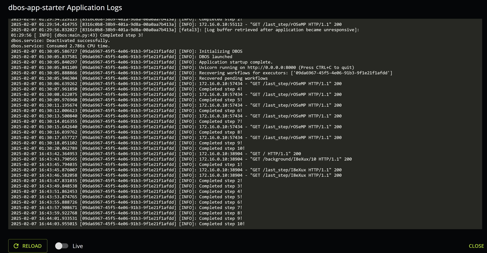
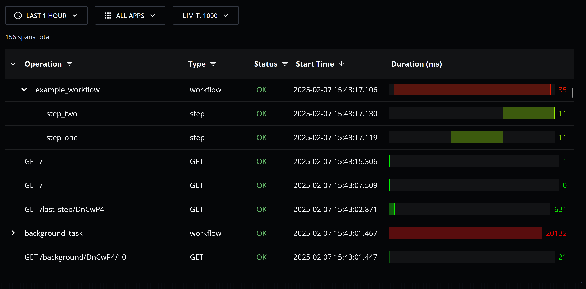

The [DBOS Cloud Console](https://console.dbos.dev) provides several tools to monitor your applications.

### Logs

You can view your application's logs from your application's cloud console page.
Logs are paginated and ordered chronologically.

### Traces

You can view traces for all your applications from the cloud console [traces page](https://console.dbos.dev/traces).
You can filter traces by application, time, operation, type, and status.
Traces are sorted chronologically and displayed hierarchically.
You can click on a trace or span to see detailed information about it.

